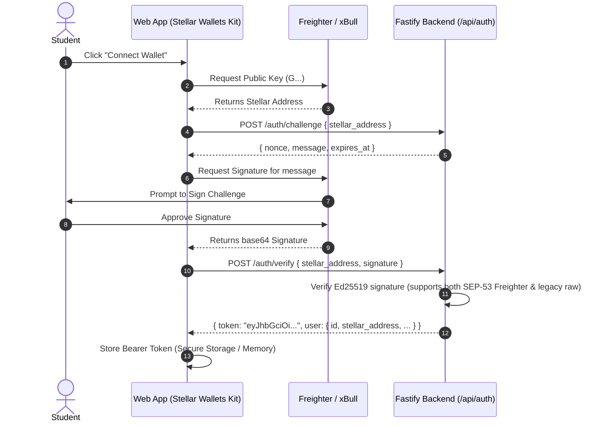

# StellarCampus Frontend Handshake & Integration Guide (`HANDSHAKE.md`)

Welcome to the **StellarCampus** API and Smart Contract integration guide. This document provides everything the frontend team needs to seamlessly connect the React/Next.js client to the Fastify backend and the deployed Soroban Testnet smart contract.

---

## 1. Network & Environment Parameters

Ensure your client-side Stellar SDK and wallet connectors use the authoritative Testnet parameters:

| Parameter | Value |
| :--- | :--- |
| **Network Passphrase** | `Test SDF Network ; September 2015` |
| **Horizon API** | `https://horizon-testnet.stellar.org` |
| **Soroban RPC URL** | `https://soroban-testnet.stellar.org` |
| **Friendbot URL** | `https://friendbot.stellar.org` |
| **Deployed Soroban Contract ID** | `CA3P7YT764IMXGP7TRLC64KYONLMCRGUJ23GIU646UKOEFSGPVE7UNFK` |
| **Campus Vault / Payment Destination** | `GAII65YQHVIE4Q2OYG73CRIQZPDN4DJNHN4W6WRUVSJBXEVWPVZ4QKAV` |
| **CAMPUS Asset Code / Issuer** | `CAMPUS` / `GAII65YQHVIE4Q2OYG73CRIQZPDN4DJNHN4W6WRUVSJBXEVWPVZ4QKAV` |
| **Backend API Base URL** | `https://stellarcampus-backend.onrender.com/api` (Live Production) / `http://localhost:3001/api` (Local Dev) |
| **Interactive Swagger Playground** | [`https://stellarcampus-backend.onrender.com/docs`](https://stellarcampus-backend.onrender.com/docs) |
| **Auth Scheme** | `Authorization: Bearer <token>` |

---

## 2. Authentication Flow (Wallet Signature → Bearer Token)

The backend never trusts a raw wallet address supplied in request bodies. Authentication is strictly cryptographic via an ed25519 signature of a dynamic challenge nonce.



> [!NOTE]
> **SEP-53 Wallet Signature Support**: The backend seamlessly handles modern **Freighter SEP-53** standard signatures (`SHA256("Stellar Signed Message:\n" + message)`) as well as legacy raw Ed25519 signatures from custom keypairs or test scripts without requiring any frontend translation.

### Auth Code Example (Client-side)
```typescript
import { StellarWalletsKit } from '@creit.tech/stellar-wallets-kit';

// 1. Get challenge nonce
const challengeRes = await fetch(`${API_BASE_URL}/auth/challenge`, {
  method: 'POST',
  headers: { 'Content-Type': 'application/json' },
  body: JSON.stringify({ stellar_address: publicKey }),
});
const { nonce, message } = await challengeRes.json();

// 2. Sign challenge message using wallet kit
const { signature } = await kit.signMessage(message);

// 3. Exchange for Bearer JWT
const verifyRes = await fetch(`${API_BASE_URL}/auth/verify`, {
  method: 'POST',
  headers: { 'Content-Type': 'application/json' },
  body: JSON.stringify({
    stellar_address: publicKey,
    signature: signature,
  }),
});
const { token, user } = await verifyRes.json();
localStorage.setItem('sc_bearer_token', token);
```

---

## 3. Challenge Lifecycle & Execution Matrix

Every challenge adheres to a strict state cycle:
```
[Select Challenge] ──> [Start Assignment: POST /challenges/:id/start]
                           │
                           ▼
               [Receive Dynamic Assigned Parameters]
               (Unique Memo / Nonce / Destination)
                           │
                           ▼
               [Execute On-Chain via Wallet / CLI]
                           │
                           ▼
          [Submit TX Hash: POST /challenges/:id/submit]
                           │
             ┌─────────────┴─────────────┐
             ▼                           ▼
      { status: "VERIFIED" }     { status: "FAILED" }
```

### Challenge 1 — Wallet Ownership Verification
- **Description**: Proves the student controls the private key corresponding to their Stellar public address.
- **Action**: Completes automatically upon successful execution of the `/api/auth/verify` endpoint.
- **Verification Endpoint**: `POST /api/challenges/wallet_verify_001/submit` with empty payload; backend confirms active verified wallet status.

### Challenge 2 — Fund a Stellar Testnet Account
- **Action**: Student requests test lumens via Stellar Friendbot (`https://friendbot.stellar.org?addr={publicKey}`).
- **Submission**: `POST /api/challenges/fund_account_002/submit` (no TX hash required; backend queries Horizon `/accounts/{publicKey}` to verify balance $\ge 1$ XLM).

### Challenge 3 — Execute an XLM Payment
- **Action**: Student sends assigned amount of XLM to the platform's assigned Testnet address.
- **Crucial Requirement**: The transaction **must** include the `assigned_memo` generated by `POST /api/challenges/payment_xlm_003/start`.
- **Client Construction Example**:
  ```typescript
  import { TransactionBuilder, Networks, Operation, Asset, Memo } from '@stellar/stellar-sdk';

  const tx = new TransactionBuilder(account, {
    fee: '100',
    networkPassphrase: Networks.TESTNET,
  })
    .addOperation(
      Operation.payment({
        destination: assignment.assigned_destination,
        asset: Asset.native(),
        amount: assignment.assigned_amount, // e.g. "2.0000000"
      })
    )
    .addMemo(Memo.text(assignment.assigned_memo)) // Anti-replay memo
    .setTimeout(180)
    .build();
  ```
- **Submission Payload**:
  ```json
  {
    "assignment_id": "assignment-uuid",
    "transaction_hash": "64_char_hex_hash"
  }
  ```

### Challenge 4 — Transfer a Supported Stellar Asset
- **Asset Config**: Asset Code `CAMPUS`, Issuer Address provided in `/challenges/asset_transfer_004` and in active assignment `assigned_parameters.asset_issuer`.
- **Complete End-to-End Frontend Flow**:
  1. **Start Assignment**: Call `POST /api/challenges/asset_transfer_004/start` to retrieve `destination`, `amount`, `asset`, `asset_issuer`, and unique `memo`.
  2. **Establish Trustline**: Prompt user via Freighter to establish a trustline for `CAMPUS`:
     ```typescript
     import { Asset, Operation, TransactionBuilder } from '@stellar/stellar-sdk';
     const campusAsset = new Asset(assignment.assigned_parameters.asset, assignment.assigned_parameters.asset_issuer);
     const tx = new TransactionBuilder(account, { fee: '10000', networkPassphrase })
       .addOperation(Operation.changeTrust({ asset: campusAsset, limit: '1000' }))
       .setTimeout(180)
       .build();
     ```
  3. **Claim Faucet Tokens**: Call `POST /api/challenges/asset_transfer_004/claim-tokens` with Bearer auth. The platform dispenses 20.0 `CAMPUS` directly to the student's wallet on Testnet.
  4. **Execute Asset Payment**: Prompt user via Freighter to transfer 10.0 `CAMPUS` to the assigned destination with the assigned unique memo.
  5. **Authoritative Verification**: Submit transaction hash to `POST /api/challenges/asset_transfer_004/submit`.
- **Submission Payload**: Same as Challenge 3.

### Challenge 5 — Interact with a Soroban Smart Contract
- **Contract Function**: `complete_challenge(student: Address, challenge_id: u32, evidence_nonce: BytesN<32>)`
- **Crucial Requirement**: The invoking wallet must be the student address, authorized via `student.require_auth()`. The `evidence_nonce` is the 32-byte hex nonce provided in the active assignment.
- **Client Invocation**:
  ```typescript
  import { Contract, Address, scValToNative, nativeToScVal } from '@stellar/stellar-sdk';

  const contract = new Contract(assignment.assigned_contract_id);
  const tx = contract.call(
    'complete_challenge',
    new Address(studentAddress).toScVal(),
    nativeToScVal(5, { type: 'u32' }),
    nativeToScVal(Buffer.from(assignment.assigned_nonce, 'hex'), { type: 'bytes' })
  );
  // Sign with wallet and submit to Soroban RPC -> Submit tx_hash to backend
  ```

---

## 4. API Endpoints Reference

All requests requiring authentication must include:
`Authorization: Bearer <token>`

| Method | Endpoint | Description |
| :--- | :--- | :--- |
| `POST` | `/api/auth/challenge` | Request unique signing nonce for address |
| `POST` | `/api/auth/verify` | Submit ed25519 signature; returns JWT Bearer token |
| `GET` | `/api/challenges` | List all 5 challenges with completion status for logged-in user |
| `GET` | `/api/challenges/:id` | Get challenge specifications, instructions, config, and active assignment |
| `POST` | `/api/challenges/:id/start` | Generate dynamic assignment (unique memo, nonce, destination, issuer) |
| `POST` | `/api/challenges/:id/claim-tokens` | Dispense 20.0 `CAMPUS` testnet tokens to authenticated student with trustline |
| `POST` | `/api/challenges/:id/submit` | Submit transaction hash for authoritative verification |
| `GET` | `/api/submissions/:id` | Poll or retrieve full verification breakdown for a submission |
| `GET` | `/api/students/me/progress` | Get overall completion progress, verified counts, pending counts |
| `GET` | `/api/students/me/history` | List all past submissions, statuses, and Stellar Explorer URLs |

---

## 5. Standard Data Types (TypeScript)

Copy these types directly into your frontend `types/api.ts`:

```typescript
export interface UserProfile {
  id: string;
  email: string;
  username: string;
  displayName: string;
  githubUsername?: string;
  stellarAddress: string;
  isWalletVerified: boolean;
  createdAt: string;
}

export interface ChallengeItem {
  id: string;
  title: string;
  description: string;
  category: 'Wallet & Account' | 'Stellar Payments' | 'Stellar Assets' | 'Soroban Smart Contracts';
  difficulty: 'Beginner' | 'Intermediate' | 'Advanced';
  network: 'testnet';
  orderIndex: number;
  status: 'LOCKED' | 'AVAILABLE' | 'IN_PROGRESS' | 'COMPLETED';
}

export interface ChallengeAssignment {
  id: string;
  challengeId: string;
  assignedMemo?: string;
  assignedNonce?: string;
  assignedDestination?: string;
  assignedAmount?: string;
  assignedAsset?: string;
  assignedContractId?: string;
  expiresAt: string;
}

export interface VerificationChecks {
  transaction_exists: boolean;
  transaction_succeeded: boolean;
  source_wallet_matches: boolean;
  destination_matches?: boolean;
  asset_matches?: boolean;
  amount_matches?: boolean;
  memo_matches?: boolean;
  contract_matches?: boolean;
  event_emitted?: boolean;
}

export interface SubmissionResponse {
  submission_id: string;
  challenge_id: string;
  status: 'PENDING' | 'VERIFIED' | 'FAILED' | 'DUPLICATE';
  failure_reason?: string;
  checks?: VerificationChecks;
  completed_at?: string;
  explorer_url?: string;
}
```

---

## 6. Verification Statuses & UI Handling (Screen 9)

When rendering **Screen 9 (Verification Result)**, the backend returns clear semantic results:

| Status | HTTP Code | UI State & Guidance |
| :--- | :--- | :--- |
| `VERIFIED` | `200 OK` | Render green success banner, display passing checkmarks for all items, trigger celebratory micro-animation, offer "Back to Challenges". |
| `FAILED` | `422 Unprocessable` | Render red/amber error banner. Display `failure_reason` verbatim (e.g. *"The transaction was sent to GABC... but expected GXYZ..."*). Display "Retry Submission" button. |
| `DUPLICATE` | `409 Conflict` | Transaction hash has already been used by another student or in a previous challenge. Prompt student to execute a new transaction with their active assignment parameters. |
| `PENDING` | `202 Accepted` | If network congestion delays Horizon ledger ingestion, the UI should show a polling spinner for up to 10 seconds before marking failed. |
