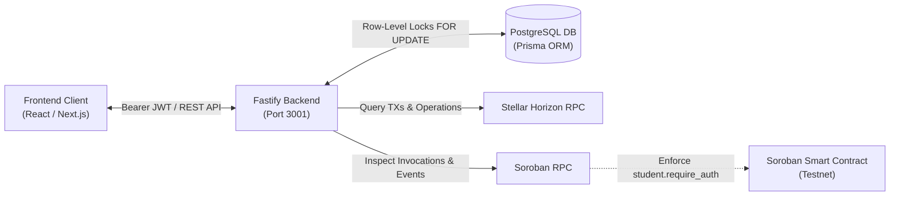

# StellarCampus 🌟

> **Automated On-Chain Verification Platform for Stellar & Soroban Developers**

StellarCampus transitions students, beginner developers, and early-career Web3 builders from passive tutorial consumption to practical, verifiable blockchain engineering tasks. Instead of traditional quizzes, every technical challenge is backed and verified by authoritative Stellar network transactions and Soroban smart contract activity.

---

## 🚀 Live Production & Testnet Deployment

The platform backend, PostgreSQL database, and challenge smart contract are fully deployed and operational on **Stellar Testnet**:

| Resource | Value / Link |
| :--- | :--- |
| **Live Production API** | [`https://stellarcampus-backend.onrender.com/api`](https://stellarcampus-backend.onrender.com/api) |
| **Live Health Check** | [`https://stellarcampus-backend.onrender.com/health`](https://stellarcampus-backend.onrender.com/health) |
| **Live Swagger UI** | [`https://stellarcampus-backend.onrender.com/docs`](https://stellarcampus-backend.onrender.com/docs) |
| **OpenAPI Specification** | [`https://stellarcampus-backend.onrender.com/docs/json`](https://stellarcampus-backend.onrender.com/docs/json) |
| **Network** | Stellar Testnet (`Test SDF Network ; September 2015`) |
| **Deployed Contract ID** | [`CA3P7YT764IMXGP7TRLC64KYONLMCRGUJ23GIU646UKOEFSGPVE7UNFK`](https://lab.stellar.org/r/testnet/contract/CA3P7YT764IMXGP7TRLC64KYONLMCRGUJ23GIU646UKOEFSGPVE7UNFK) |
| **Campus Vault / Payment Destination** | [`GAII65YQHVIE4Q2OYG73CRIQZPDN4DJNHN4W6WRUVSJBXEVWPVZ4QKAV`](https://stellar.expert/explorer/testnet/account/GAII65YQHVIE4Q2OYG73CRIQZPDN4DJNHN4W6WRUVSJBXEVWPVZ4QKAV) |
| **CAMPUS Asset Code / Issuer** | `CAMPUS` / [`GAII65YQHVIE4Q2OYG73CRIQZPDN4DJNHN4W6WRUVSJBXEVWPVZ4QKAV`](https://stellar.expert/explorer/testnet/account/GAII65YQHVIE4Q2OYG73CRIQZPDN4DJNHN4W6WRUVSJBXEVWPVZ4QKAV) |
| **Horizon RPC** | `https://horizon-testnet.stellar.org` |
| **Soroban RPC** | `https://soroban-testnet.stellar.org` |

---

## 📚 Essential Documentation

| Document | Purpose |
| :--- | :--- |
| **[Swagger UI Playground](https://stellarcampus-backend.onrender.com/docs)** | **Live Interactive API Playground**: Test endpoints directly from the browser (`/docs`) with Bearer token authentication and schema models. *(Local: `http://localhost:3001/docs`)* |
| **[API.md](./API.md)** | **Exhaustive REST API Documentation**: Offline Markdown reference for request/response schemas, status codes, and error bodies for all endpoints. |
| **[HANDSHAKE.md](./HANDSHAKE.md)** | **Frontend Integration Contract**: TypeScript types, Stellar Wallets Kit signing flow, challenge-by-challenge execution instructions, and UI state mappings. |
| **[RESUME.md](./RESUME.md)** | **Senior Engineering Portfolio Case Study**: In-depth architecture breakdown, concurrency defense tradeoffs, SEP-53 cryptographic domain separation, and testnet verification results. |
| **[AGENTS.md](./AGENTS.md)** | **Engineering Mandates & Operating Rules**: Repository constraints, architecture decisions, and git instructions. |

---

## 🛠️ Architecture & Technology Stack



- **Smart Contract**: Rust with `soroban-sdk` (v22), strictly requiring `student.require_auth()`, maintaining persistent completion counters, and emitting indexed Soroban events.
- **Backend API**: Node.js (v22 LTS) + TypeScript + Fastify (v5).
- **Database & ORM**: PostgreSQL with Prisma ORM.
- **Authentication**: Cryptographic wallet ownership validation (Ed25519 signature of a dynamic nonce) issuing a 24-hour Bearer JWT.
- **Concurrency & Anti-Replay Defense**: Native PostgreSQL pessimistic row-level locking (`SELECT ... FOR UPDATE` inside an interactive Prisma `$transaction`) paired with unique database constraints on transaction hashes.

---

## 🎯 Initial Core Challenges

1. **Challenge 1 — Wallet Ownership Verification (`wallet_verify_001`)**: Proves control of the student's Stellar private key via Ed25519 challenge-response. Automatically credits completion upon authentication.
2. **Challenge 2 — Fund a Stellar Testnet Account (`fund_account_002`)**: Connects to Friendbot and verifies that the student account has been created with $\ge 1$ XLM balance.
3. **Challenge 3 — Execute an XLM Payment (`payment_xlm_003`)**: Transmits 2.0 XLM to the Campus Vault matching the student's assigned dynamic memo reference (e.g. `SC-491029`).
4. **Challenge 4 — Transfer a Supported Stellar Asset (`asset_transfer_004`)**: Establishes a trustline for the `CAMPUS` test token, claims test tokens from the platform faucet (`/api/challenges/asset_transfer_004/claim-tokens`), and transfers 10.0 CAMPUS tokens to the vault with the assigned dynamic memo.
5. **Challenge 5 — Interact with a Soroban Smart Contract (`soroban_contract_005`)**: Invokes `complete_challenge` on the deployed Soroban contract on Testnet with student wallet authorization.

---

## 💻 Local Development Setup

### Prerequisites
- **Node.js**: v22+ & npm v10+
- **Rust & Cargo**: v1.84+ with target `wasm32-unknown-unknown`
- **PostgreSQL**: v15+ running on `localhost:5432`
- **Stellar CLI**: `brew install stellar-cli`

### 1. Database Setup
Ensure PostgreSQL is running locally, then initialize the database:
```bash
createdb stellarcampus
```

### 2. Backend Setup
```bash
cd backend

# Copy environment variables
cp .env.example .env

# Install dependencies
npm install

# Generate Prisma Client & push schema
npx prisma generate
npx prisma db push

# Seed initial 5 challenges
npm run prisma:seed

# Run dev server (http://localhost:3001)
npm run dev
```

### 3. Running Backend Automated Tests
```bash
cd backend
npm test
```
*Executes all 15 Vitest tests covering Ed25519 cryptographic authentication, SEP-53 domain separation, Horizon payment verification rules, asset faucet claiming, and row-level locking concurrency controls.*

### 4. Running Smart Contract Tests & Building WASM
```bash
cd contracts/challenge-contract

# Run unit tests (6/6 passing)
cargo test

# Build optimized release WASM
cargo build --target wasm32-unknown-unknown --release
```

### 5. Running End-to-End Live Testnet Simulation (5/5 Challenges)
Run the automated end-to-end student flow that validates all 5 challenges against live Stellar Testnet:
```bash
# Run against live Render production deployment
cd backend
npm run test:e2e:prod

# Or run against local dev server (requires backend running on localhost:3001)
npm run test:e2e
```
*Creates a fresh Testnet wallet, claims 10,000 Friendbot XLM, performs cryptographic SEP-53 authentication, creates dynamic assignments, submits on-chain XLM and CAMPUS payments to the vault, executes Soroban contract invocations, and verifies 100% completion.*

---

## 🔑 Environment Variables & Testnet Credentials Reference

The following credentials and configuration parameters govern the StellarCampus backend:

| Variable | Environment | Description | Live Testnet Value |
| :--- | :--- | :--- | :--- |
| `PORT` | All | HTTP server port | `3001` |
| `NODE_ENV` | Prod / Dev | Runtime environment mode | `production` / `development` |
| `DATABASE_URL` | All | PostgreSQL connection string | `postgresql://...` (Render managed or local) |
| `JWT_SECRET` | All | Bearer token signing secret | Cryptographic 64+ char random string |
| `STELLAR_NETWORK_PASSPHRASE` | All | Stellar network identifier | `Test SDF Network ; September 2015` |
| `STELLAR_HORIZON_URL` | All | Horizon RPC endpoint | `https://horizon-testnet.stellar.org` |
| `STELLAR_SOROBAN_RPC_URL` | All | Soroban RPC endpoint | `https://soroban-testnet.stellar.org` |
| `SOROBAN_CONTRACT_ID` | All | Deployed challenge smart contract | [`CA3P7YT764IMXGP7TRLC64KYONLMCRGUJ23GIU646UKOEFSGPVE7UNFK`](https://lab.stellar.org/r/testnet/contract/CA3P7YT764IMXGP7TRLC64KYONLMCRGUJ23GIU646UKOEFSGPVE7UNFK) |
| `CAMPUS_VAULT_ADDRESS` | All | Payment destination address for challenges | [`GAII65YQHVIE4Q2OYG73CRIQZPDN4DJNHN4W6WRUVSJBXEVWPVZ4QKAV`](https://stellar.expert/explorer/testnet/account/GAII65YQHVIE4Q2OYG73CRIQZPDN4DJNHN4W6WRUVSJBXEVWPVZ4QKAV) |
| `CAMPUS_ASSET_ISSUER` | All | Public key of the `CAMPUS` test token issuer | [`GAII65YQHVIE4Q2OYG73CRIQZPDN4DJNHN4W6WRUVSJBXEVWPVZ4QKAV`](https://stellar.expert/explorer/testnet/account/GAII65YQHVIE4Q2OYG73CRIQZPDN4DJNHN4W6WRUVSJBXEVWPVZ4QKAV) |
| `CAMPUS_ISSUER_SECRET` | Backend | Secret seed of the `CAMPUS` asset issuer for automated platform faucet | Dedicated Testnet funding seed (`SC...`) |

---

## 🚢 Cloud Deployment & Infrastructure (Render)

The platform is configured for zero-downtime cloud hosting using [Render](https://render.com):
- **Web Service (`srv-dbc8vbbrjlhs73b7n700`)**: Running Fastify on Node.js 22 LTS with automated `prisma db push` and `prisma:seed` execution during deployment.
- **Database (`dpg-dbc8t3bbc2fs73bmdn4g-a`)**: Managed PostgreSQL 16 Starter instance (`0.1 CPU, 256 MB RAM, 15 GB persistent SSD`) hosting `stellarcampus-db`.
- **Infrastructure-as-Code Blueprint**: Defined in [`render.yaml`](./render.yaml) for one-click environment replication.
- **Continuous Integration**: GitHub Actions workflow at [`.github/workflows/ci.yml`](./.github/workflows/ci.yml) builds and tests both Rust Soroban contracts and TypeScript Fastify services on every push.

---

## 🤝 Seamless Handover & Role Guides

| Target Role | Recommended Starting Point | Key Takeaway |
| :--- | :--- | :--- |
| **Frontend Engineers** | [**`HANDSHAKE.md`**](./HANDSHAKE.md) | Authoritative integration spec with TypeScript interfaces, Stellar Wallets Kit signing flow, challenge instructions, and error handling. |
| **Backend & DevOps Engineers** | [**`backend/`**](./backend) & [**`render.yaml`**](./render.yaml) | Fastify server architecture, Prisma schema, PostgreSQL row-level locks, and deployment automation. |
| **Smart Contract Engineers** | [**`contracts/challenge-contract/`**](./contracts/challenge-contract) | Soroban Rust contract source, `#![no_std]` testing harness, and TTL management. |
| **API Docs** | [**Live Swagger UI**](https://stellarcampus-backend.onrender.com/docs) | Senior engineering tradeoffs (SEP-53 domain separation, PostgreSQL row locks vs Redis, idempotent retry architectures). |
